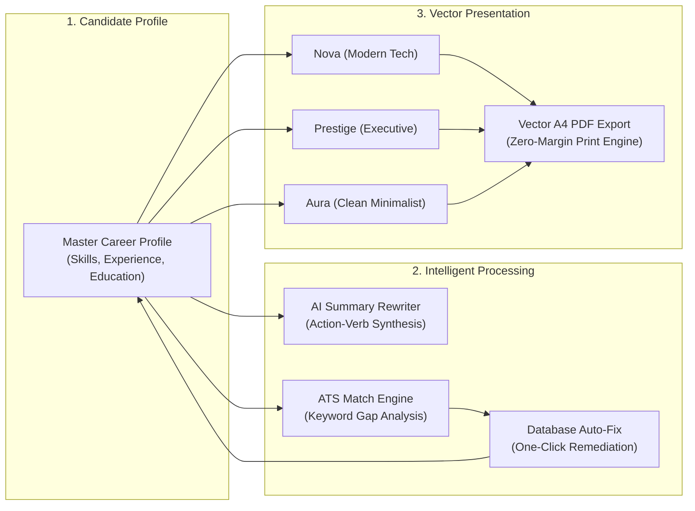
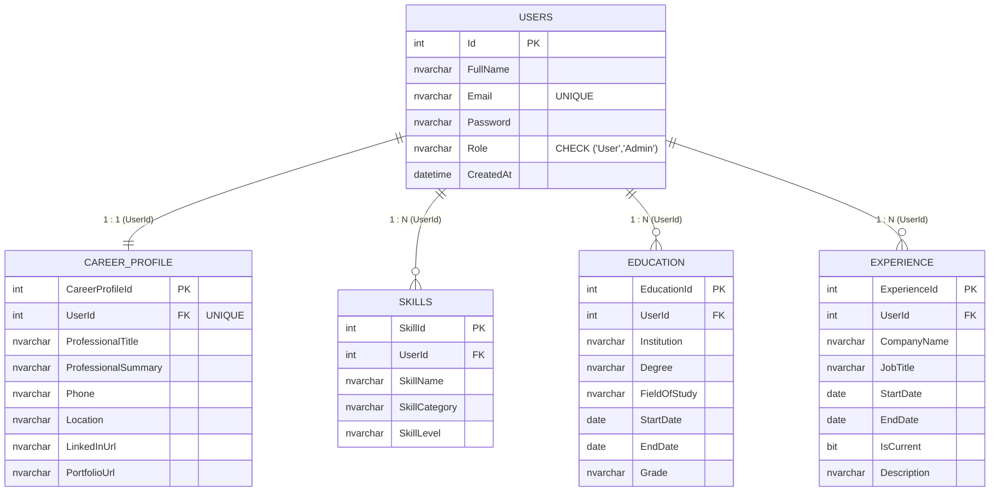

# ResumeAI — AI Resume Builder & ATS Optimization Platform

[](https://dotnet.microsoft.com/)
[](https://dotnet.microsoft.com/apps/aspnet)
[](https://docs.microsoft.com/dotnet/csharp/)
[](https://www.microsoft.com/sql-server/)
[](https://visualstudio.microsoft.com/)
[](LICENSE.txt)

**ResumeAI** is an enterprise-grade ASP.NET Web Forms web application designed to help job seekers create, optimize, and export recruiter-grade, ATS-ready resumes. Featuring a robust 3-tier architecture, an integrated AI career assistance engine, live interactive builders, and pixel-perfect vector A4 PDF rendering, the platform bridges modern generative AI capabilities with reliable enterprise .NET technology.

---

## Technical Documentation Index

For in-depth architectural breakdowns, database schema specifications, and implementation details, refer to the dedicated documentation in the [`docs/`](docs/) directory:

| Document | Description |
| :--- | :--- |
| **[System Architecture](docs/architecture.md)** | Unified Master Page pattern, ASP.NET lifecycle, state management, and subsystem interaction |
| **[Database Schema & ER](docs/database.md)** | Complete 5-table relational design, entity diagrams, cascading foreign keys, and seed scripts |
| **[AI Integration Engine](docs/ai-integration.md)** | `AiHelper.cs` architecture, lightweight `HttpClient` REST patterns, prompt structure, and fail-safe fallbacks |
| **[Templates & PDF Export](docs/templates-and-pdf.md)** | Dynamic layout engine, Nova / Prestige / Aura layouts, embedded CSS guarantees, and print calibration |
| **[Administration & Security](docs/admin-and-security.md)** | Admin portal, command-based `RowCommand` CRUD pattern, self-deletion guards, and session state guards |
| **[Local Setup & Installation](docs/setup-guide.md)** | Step-by-step developer setup, Visual Studio configuration, LocalDB initialization, and troubleshooting |

---

## Key Platform Capabilities



### 1. Intelligent AI Career Assistance
* **AI Summary Rewrite**: Formulates punchy, metric-driven professional summaries tailored to target job titles in a single click.
* **AI ATS Readiness Inspector**: Audits resumes against hiring filters, computing overall readiness gauges, keyword alignment, content quality, and actionable recommendations.
* **Database Auto-Fix**: Automatically resolves identified skill gaps by inserting missing industry competencies directly into the candidate's SQL profile.
* **Resilient Fail-Safe Architecture**: Uses standard `HttpClient` with automatic fallback heuristics to ensure continuous availability even during network disruptions.

### 2. Recruiter-Approved Resume Templates
* **Nova (Modern Tech)**: Top accent stripe, bold typography, inline SVG contact markers, and neatly wrapped skill pill tags.
* **Prestige (Executive / Harvard Classic)**: Traditional single-column corporate layout, centered serif headings, balanced chronological date rows, and formal divider rules.
* **Aura (Clean Minimalist / Silicon Valley)**: Split asymmetric header, primary-color left border section indicators, and soft neutral badge tags.
* **Zero-Cache Invalidation Bug Guarantee**: Injects fully self-contained CSS styles directly within the document container to prevent browser caching glitches.

### 3. High-DPI Vector PDF Export
* Full compliance with global **A4 portrait** specifications (`@page { size: A4 portrait; margin: 0; }`).
* Automatically suppresses all application navigation chrome, sidebars, and ambient effects during print.
* Generates razor-sharp vector text and SVG assets suitable for direct submission to Applicant Tracking Systems (Workday, Greenhouse, Lever).

### 4. Administrative Control Center
* Live candidate management via ASP.NET `GridView`.
* Implements the robust **Top-Form `RowCommand` pattern** (`cmd_edit`, `cmd_delete`) using `ViewState["Id"]` state retention.
* Built-in security guards preventing self-deletion of the active administrator account and protecting credential privacy.

---

## Relational Database Architecture

The application database is built around a candidate-centric relational model comprising 5 normalized tables with cascading referential integrity:



*For comprehensive table definitions, constraints, and seeding instructions, see [`docs/database.md`](docs/database.md).*

---

## Project Structure

```
CSharp_AIResumeWebApplication/
├── AI-Resume WebApplication/           # Main Web Forms Project Root
│   ├── App_Data/
│   │   ├── AIResume_Database.sql      # Database schema creation & seed script
│   │   └── ApplicationDatabase.mdf    # Microsoft SQL Server LocalDB file
│   ├── assets/
│   │   ├── css/                       # Design tokens, layouts, and templates.css
│   │   └── js/                        # Filter controllers, theme scripts, and app.js
│   ├── Website.Master                 # Unified Master Page shell
│   ├── Default.aspx                   # Public landing page & platform overview
│   ├── Login.aspx / Register.aspx     # Candidate & Admin authentication
│   ├── Dashboard.aspx                 # Candidate analytics and quick actions
│   ├── Profile.aspx                   # Multi-section candidate profile manager
│   ├── Templates.aspx                 # Interactive template gallery with live filtering
│   ├── ResumeBuilder.aspx             # Real-time resume customizer & AI rewriter
│   ├── Preview.aspx                   # Standalone A4 vector PDF print viewer
│   ├── Analyzer.aspx                  # AI ATS inspector & database auto-fix
│   ├── AdminPanel.aspx                # Administrative user management portal
│   ├── AiHelper.cs                    # Lightweight HTTP AI communication engine
│   ├── ResumeTemplateBase.cs          # Multi-template HTML/CSS rendering engine
│   └── Web.config                     # Database connections & AI endpoint settings
├── docs/                              # In-depth architectural & technical documentation
│   ├── architecture.md
│   ├── database.md
│   ├── ai-integration.md
│   ├── templates-and-pdf.md
│   ├── admin-and-security.md
│   └── setup-guide.md
├── AI-Resume WebApplication.sln       # Visual Studio 2022 Solution
├── setup.bat                          # One-click dependency restore & build script
├── LICENSE.txt                        # MIT Open Source License
└── README.md                          # Project documentation
```

---

## Quickstart & Local Setup

### Prerequisites
* Windows 10 / 11
* [Visual Studio 2022](https://visualstudio.microsoft.com/) with **ASP.NET and web development** workload
* .NET Framework 4.8.1 Developer Pack
* Microsoft SQL Server Express / LocalDB

### 1-Click Launch
1. Clone or download the repository.
2. Run `setup.bat` from the root directory to restore NuGet packages and build the project.
3. Open `AI-Resume WebApplication.sln` in Visual Studio 2022 and press **Ctrl + F5** to run in IIS Express.

### Pre-Seeded Evaluation Accounts
| Account Type | Email | Password | Landing Page |
| :--- | :--- | :--- | :--- |
| **Administrator** | `admin@resumeai.com` | `admin123` | `AdminPanel.aspx` |
| **Demo Candidate** | `demo@resumeai.com` | `demo123` | `Dashboard.aspx` |

*For complete setup instructions and troubleshooting, see [`docs/setup-guide.md`](docs/setup-guide.md).*

---

## License

This project is open-source and distributed under the [MIT License](LICENSE.txt).
