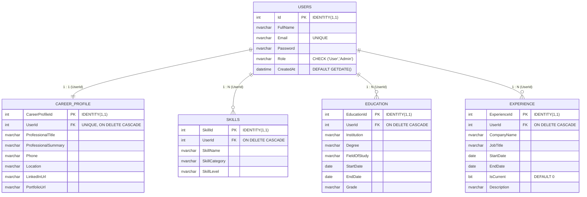

# AI-Resume WebApplication

[](https://dotnet.microsoft.com/)
[](https://dotnet.microsoft.com/apps/aspnet)
[](https://docs.microsoft.com/dotnet/csharp/)
[](https://www.microsoft.com/sql-server/)
[](https://visualstudio.microsoft.com/)
[](LICENSE.txt)

An enterprise-ready ASP.NET Web Forms application designed for building, formatting, and analyzing AI-assisted resumes. Built with a unified Master Page architecture, robust Session-driven security, an administrative control panel, and an ATS readiness analysis engine.

---

## Table of Contents

- [Overview & Architecture](#overview--architecture)
- [Team Contributions & Authorship](#team-contributions--authorship)
- [Relational Database Design (5 Tables)](#relational-database-design-5-tables)
- [Key Features](#key-features)
  - [Authentication & Role Management](#authentication--role-management)
  - [Administrative Control Panel](#administrative-control-panel)
  - [Unified Candidate Profile](#unified-candidate-profile)
  - [Resume Templates Engine](#resume-templates-engine)
  - [AI ATS Resume Analyzer](#ai-ats-resume-analyzer)
- [Project Structure](#project-structure)
- [Getting Started & Local Setup](#getting-started--local-setup)
- [Git Workflow & Remote Repository Instructions](#git-workflow--remote-repository-instructions)
- [License](#license)

---

## Overview & Architecture

**AI-Resume WebApplication** uses a single, unified master page (`Website.Master`) that toggles view states dynamically through server-side `asp:Panel` controls. This eliminates master-page redundancy and provides consistent layout across public landing pages, candidate profile forms, and the administrative dashboard.

### Core Architectural Principles:
1. **Unified Page Shell**: `Website.Master` delivers a cohesive header, drawer navigation, and footer across all views.
2. **Faculty Reference Pattern Compliance**:
   - Replaces fragile inline GridView edit templates (`RowEditing`, `RowUpdating`, `FindControl()` casting) with clean `ButtonField` commands (`cmd_edit`, `cmd_delete`) via `RowCommand`.
   - Utilizes `ViewState["Id"]` to track record selection and toggle button semantics dynamically (e.g., `Add User` &rarr; `Update User`).
3. **Session State Security**: Centralized authentication tracking using `Session["userId"]`, `Session["userName"]`, and `Session["role"]` with automatic redirection for unauthenticated or non-admin requests.
4. **Clean Presentation Separation**: Independent token-based design system (`assets/css/tokens.css`, `variables.css`, `base.css`) combined with print-optimized stylesheets (`templates.css`) for high-fidelity PDF generation.

---

## Team Contributions & Authorship

This project was developed by a team of 3 contributors with clearly partitioned architectural responsibilities:

| Contributor | Role | Contribution % | Primary Modules & Responsibilities |
|-------------|------|:--------------:|-------------------------------------|
| **Jaiminsinh Dodiya** (`Jaiminsinh-Dodiya`) | **Lead Programmer** | **55%** | Resume Template Engine (`ResumeTemplateBase.cs`), Template Gallery (`Templates.aspx`), Interactive Resume Builder (`ResumeBuilder.aspx`), Standalone Resume Preview (`Preview.aspx`), AI ATS Analyzer (`Analyzer.aspx`), `CareerProfile` database table, User Panel core integration, and Visual Studio solution architecture. |
| **WilliamSinh Parmar** (`WilliamSinhParmar`) | **Full-Stack & UI Developer** | **25%** | 3 Database Tables (`Skills`, `Education`, `Experience`), User Panel management sections in `Profile.aspx` (Skills, Education, Experience CRUD), User Dashboard widgets (`Dashboard.aspx`), User Settings (`Settings.aspx`), CSS design system, typography tokens, animations, and print media queries (`templates.css`). |
| **Prinsooo** (`Prinsooo`) | **Backend & Security Developer** | **20%** | `Users` database table, User Registration (`Register.aspx`), User Login (`Login.aspx`), Session authorization, complete Admin Panel (`AdminPanel.aspx`, `AdminPanel.aspx.cs`) with custom `RowCommand` CRUD pattern, self-deletion prevention, and faculty reports. |

---

## Relational Database Design (5 Tables)

The relational schema is defined in [`App_Data/AIResume_Database.sql`](AI-Resume%20WebApplication/App_Data/AIResume_Database.sql) and enforces strict referential integrity with cascading deletes (`ON DELETE CASCADE`).



### Table Breakdown:
1. **`Users`** *(Authored by Prinsooo)*: Stores login credentials, account role (`User` or `Admin`), and creation timestamp. Unique constraint on `Email`.
2. **`CareerProfile`** *(Authored by Jaiminsinh Dodiya)*: 1-to-1 table storing professional summary, title, phone, location, LinkedIn, and portfolio links.
3. **`Skills`** *(Authored by WilliamSinh Parmar)*: 1-to-N table storing candidate skills, categories (e.g. Programming, Database), and proficiency levels.
4. **`Education`** *(Authored by WilliamSinh Parmar)*: 1-to-N table tracking academic qualifications, institutions, degrees, and graduation dates.
5. **`Experience`** *(Authored by WilliamSinh Parmar)*: 1-to-N table tracking past and current employment history with boolean `IsCurrent` flag.

---

## Key Features

### Authentication & Role Management
- **Registration (`Register.aspx`)**: Client and server-side validation, password match verification, duplicate email checking.
- **Login (`Login.aspx`)**: Secure authentication against SQL Server, session initialization (`Session["userId"]`, `Session["userName"]`, `Session["role"]`).
- **Role-Based Redirection**: Administrators automatically land on `AdminPanel.aspx`; candidates land on `Dashboard.aspx`.
- **Logout (`Logout.aspx`)**: Session invalidation and secure redirection.

### Administrative Control Panel
- **User Management (`AdminPanel.aspx`)**:
  - Live GridView of all registered users.
  - Add new users with assigned roles (`User` or `Admin`).
  - Edit existing records using custom `cmd_edit` `RowCommand` &mdash; automatically loads selected values into top form and switches submit action to `Update User`.
  - Delete user records with cascade cleanup (`ON DELETE CASCADE`) and safety guard preventing admins from deleting their active account.

### Unified Candidate Profile
- **`Profile.aspx`**: Single intuitive management hub combining:
  - Career Profile overview (Title, summary, contact details, social links).
  - Technical & Soft Skills inventory with category tags and proficiency levels.
  - Academic Education timeline with degree, institution, and grades.
  - Work Experience history with current employer toggle.

### Resume Templates Engine
- **Engine Architecture (`ResumeTemplateBase.cs`)**:
  - **Modern Template**: Clean dual-column layout with sidebar for contact, skills, and education, and primary column for summary and experience timeline.
  - **Executive Template**: Traditional, formal format with elegant typography and chronological experience highlights.
  - **Minimalist Template**: Modern single-column layout maximizing whitespace and readability.
- **Live Builder (`ResumeBuilder.aspx`)**: Real-time template switching preserved via `ViewState["CurrentTemplate"]`.
- **Preview & Export (`Preview.aspx`)**: Standalone printable view with `@media print` CSS for standard A4 and PDF output.

### AI ATS Resume Analyzer
- **`Analyzer.aspx`**:
  - Computes ATS readiness scores based on profile completeness, keyword density, and summary depth.
  - Surfaces actionable suggestions to improve resume visibility with hiring algorithms.
  - Includes "AI Smart Rewrite" triggers within the resume builder.

---

## Project Structure

```
CSharp_AIResumeWebApplication/
├── AI-Resume WebApplication/               # Main ASP.NET Web Forms Project
│   ├── App_Data/
│   │   └── AIResume_Database.sql          # 5-table relational schema & seed script
│   ├── assets/
│   │   ├── css/                           # Design tokens, components, layouts, templates.css
│   │   ├── js/                            # Theme switcher, UI controllers, app.js
│   │   └── animations/                    # Smooth UI interactions & canvas animations
│   ├── Website.Master                     # Unified Master Page shell
│   ├── Default.aspx                       # Landing page & feature showcase
│   ├── Login.aspx                         # Authentication portal
│   ├── Register.aspx                      # Candidate registration
│   ├── Logout.aspx                        # Session cleanup
│   ├── AdminPanel.aspx                    # Administrative control center
│   ├── Dashboard.aspx                     # Candidate home dashboard
│   ├── Profile.aspx                       # Multi-section candidate profile manager
│   ├── Templates.aspx                     # Resume templates visual gallery
│   ├── ResumeBuilder.aspx                 # Interactive resume customizer
│   ├── Preview.aspx                       # Print-ready resume renderer
│   ├── Analyzer.aspx                      # AI ATS readiness scoring
│   ├── Settings.aspx                      # Account preferences & password update
│   ├── ResumeTemplateBase.cs              # Base template rendering engine
│   ├── Web.config                         # Connection strings & ASP.NET configuration
│   └── packages.config                    # NuGet dependencies
├── AI-Resume WebApplication.sln           # Visual Studio 2022 Solution
├── setup.bat                              # One-click NuGet restore & MSBuild script
├── NuGet.Config                           # Official NuGet package source mapping
├── LICENSE.txt                            # MIT License
└── README.md                              # Comprehensive project documentation
```

---

## Getting Started & Local Setup

### Prerequisites
- **Visual Studio 2022** (Community, Professional, or Enterprise) with **ASP.NET and web development** workload.
- **.NET Framework 4.8.1 Developer Pack**.
- **Microsoft SQL Server Express / LocalDB** (`(LocalDB)\MSSQLLocalDB`).

### 1. Database Setup
1. Open **Visual Studio 2022**.
2. Open **Server Explorer** (`View > Server Explorer`).
3. Under **Data Connections**, connect to `(LocalDB)\MSSQLLocalDB` or right-click `ApplicationDatabase.mdf` inside `App_Data/`.
4. Open [`AI-Resume WebApplication/App_Data/AIResume_Database.sql`](AI-Resume%20WebApplication/App_Data/AIResume_Database.sql).
5. Execute the script to create all 5 tables and insert test seed records.

### 2. Build & Run
#### Option A: Visual Studio (Recommended)
1. Double-click `AI-Resume WebApplication.sln` to open in Visual Studio 2022.
2. Select `Debug | Any CPU`.
3. Press **F5** or click **IIS Express** to build and launch in your default browser.

#### Option B: One-Click Setup Script
```cmd
setup.bat
```
`setup.bat` automatically bootstraps `nuget.exe`, restores packages, and compiles the solution using MSBuild.

### 3. Default Test Credentials
| Account Type | Email | Password | Destination |
|--------------|-------|----------|-------------|
| **Administrator** | `admin@resumeai.com` | `admin123` | `AdminPanel.aspx` |
| **Demo Candidate** | `demo@resumeai.com` | `demo123` | `Dashboard.aspx` |

---

## Git Workflow & Remote Repository Instructions

This repository is maintained with two core branches:
- **`main`**: Stable, production-ready releases (tagged at semantic milestones).
- **`development`**: Active feature integration and sprint development.

### How to Connect to Your Empty Remote Repository

To link this local repository with your empty GitHub or GitLab repository, run the following commands in PowerShell or Command Prompt:

```bash
# 1. Navigate to the project root directory
cd d:\FORAI\CSharp_AIResumeWebApplication

# 2. Add your remote repository URL as origin
git remote add origin https://github.com/YOUR_USERNAME/YOUR_REPOSITORY.git

# 3. Push the main branch to the remote
git push -u origin main

# 4. Push the development branch to the remote
git push -u origin development

# 5. Push all milestone release tags to the remote
git push origin --tags
```

### Release Milestones & Tags:
- `v0.1.0-alpha`: Initial Web Forms scaffolding, layout shell, and design system.
- `v0.2.0-db-schema`: Complete 5-table relational database schema with sample seed data.
- `v0.3.0-auth`: User Registration, Login, Session role management & Logout.
- `v0.4.0-admin-panel`: Admin Panel CRUD with GridView RowCommand pattern.
- `v0.5.0-user-profile`: Multi-section User Profile (CareerProfile, Skills, Education, Experience).
- `v0.6.0-templates`: Resume templates (Modern, Executive, Minimalist) & Builder.
- `v0.7.0-ai-analyzer`: AI ATS Resume Analyzer & score diagnostics.
- `v1.0.0`: Production release with unified navigation and full documentation.

---

## License

This project is licensed under the [MIT License](LICENSE.txt).
