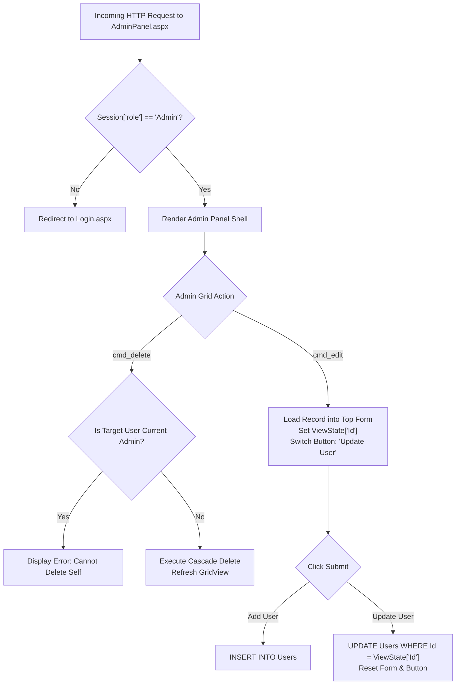

# Administration & Security Architecture

## 1. Administrative Control Center (`AdminPanel.aspx`)

The application features an administrative portal engineered for robust, maintainable user lifecycle management while maintaining enterprise-level data safety.



---

## 2. The Command-Based Pattern (`RowCommand`)

Traditional ASP.NET `GridView` inline editing (`ShowEditButton="True"`, `RowEditing`, `RowUpdating`, `RowCancelingEdit`) often introduces brittle casting issues with `FindControl()` and complex template nesting.

To ensure clarity, robustness, and maintainable separation of concerns, `AdminPanel.aspx` implements the **Top-Form RowCommand Pattern**:

1. **Clean Command Dispatch**: The GridView defines straightforward `ButtonField` elements:
   ```xml
   <asp:ButtonField CommandName="cmd_edit" Text="Edit" ButtonType="Button" ControlStyle-CssClass="btn btn-secondary btn-sm" />
   <asp:ButtonField CommandName="cmd_delete" Text="Delete" ButtonType="Button" ControlStyle-CssClass="btn btn-danger btn-sm" />
   ```
2. **State Retention via `ViewState`**:
   * When **Edit** is clicked, `GridView1_RowCommand` reads the row index, retrieves the user's primary key, and stores it in `ViewState["Id"]`.
   * Form inputs (`txtFullName`, `txtEmail`, `ddlRole`) are populated with the selected record's values.
   * The submission button text toggles from **"Add User"** to **"Update User"**.
3. **Unified Submission Handler (`btnAdd_Click`)**:
   * Evaluates `btnAdd.Text`:
     * If `"Add User"`: Executes parameterized `INSERT INTO Users`.
     * If `"Update User"`: Executes parameterized `UPDATE Users WHERE Id = @Id` using `ViewState["Id"]`.
   * Clears form fields, resets `ViewState["Id"] = null`, restores button text to `"Add User"`, and refreshes the GridView.

---

## 3. Security Guards & Safeguards

### 3.1 Session-Based Access Control
Every protected page enforces strict session verification at the top of `Page_Load`:
```csharp
if (Session["userId"] == null)
{
    Response.Redirect("Login.aspx");
    return;
}
```
For `AdminPanel.aspx`, an additional role check prevents privilege escalation:
```csharp
if (Session["role"] == null || Session["role"].ToString() != "Admin")
{
    Response.Redirect("Dashboard.aspx");
    return;
}
```

### 3.2 Self-Deletion Prevention Guard
To prevent an administrator from accidentally locking themselves out of the system, `AdminPanel.aspx.cs` checks the target ID before executing any delete statement:
```csharp
if (userId == Session["userId"].ToString())
{
    lblStatus.Text = "You cannot delete your own active administrative account.";
    lblStatus.CssClass = "badge badge-danger";
    lblStatus.Visible = true;
    return;
}
```

### 3.3 Credential Privacy Protection
* The `GridView` in `AdminPanel.aspx` deliberately excludes the `Password` column from display.
* When editing a user, the password input field remains empty by default, preventing sensitive authentication credentials from being exposed in HTML source or ViewState payloads.
