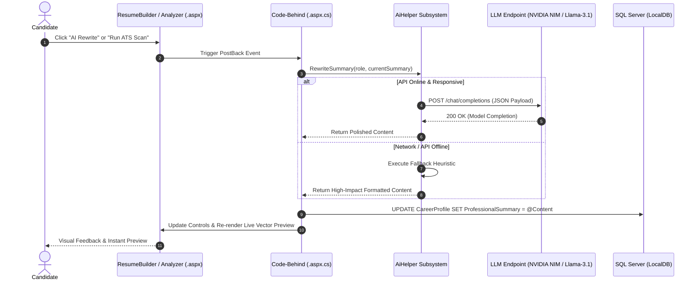

# AI Integration & Intelligent Career Assistance

## 1. Design Philosophy

The AI subsystem (`AiHelper.cs`) is designed to bring modern Generative AI capabilities into an ASP.NET Web Forms project using standard, clean, and transparent .NET networking primitives:

* **No Proprietary AI SDKs**: Avoids bulky, high-abstraction third-party libraries.
* **Lightweight Native Transport**: Directly utilizes `System.Net.Http.HttpClient` and `Newtonsoft.Json`, avoiding vendor SDK lock-in.
* **Fail-Safe Reliability**: Built-in heuristic fallback logic ensures that the application never breaks or hangs during network outages, sandbox isolation, or rate-limited environments.



---

## 2. Configuration (`Web.config`)

The AI engine connects to standard OpenAI-compatible REST endpoints configured through `<appSettings>` in `Web.config`:

```xml
<appSettings>
  <!-- AI Endpoint Configuration -->
  <add key="AIApiEndpoint" value="https://integrate.api.nvidia.com/v1/chat/completions" />
  <add key="AIModel" value="meta/llama-3.1-8b-instruct" />
  <add key="AIApiKey" value="nvapi-YOUR-API-KEY-HERE" />
</appSettings>
```

---

## 3. Core Features & Capabilities

### 3.1 AI Professional Summary Rewrite (`RewriteSummary`)
* **Trigger**: Candidate clicks the **"AI Rewrite"** button adjacent to the summary textarea in [`ResumeBuilder.aspx`](../AI-Resume%20WebApplication/ResumeBuilder.aspx).
* **Process**:
  1. Captures the target job title (`txtTargetTitle.Text`) and current summary draft (`txtSummary.Text`).
  2. Constructs a specialized prompt instructing the model to act as a senior technical recruiter and rewrite the summary using high-impact action verbs and quantitative metrics.
  3. Updates the `txtSummary` input control, persists the result directly into `CareerProfile.ProfessionalSummary` in SQL Server, and triggers `RenderPreview()` to refresh the resume preview instantaneously.

### 3.2 AI ATS Inspector & Scoring Engine (`AnalyzeResume`)
* **Trigger**: Candidate loads or requests an audit in [`Analyzer.aspx`](../AI-Resume%20WebApplication/Analyzer.aspx).
* **Process**:
  1. Gathers the candidate's complete profile (`CareerProfile`, `Skills`, `Education`, `Experience`) from the database.
  2. Submits the profile to the ATS inspector prompt.
  3. Returns a structured JSON evaluation covering:
     * **Overall ATS Readiness Score** (0–100%)
     * **Content Quality Score** & **Keyword Match Score**
     * **Identified Strengths**
     * **Missing Critical Skills** (e.g., Docker, CI/CD, Microservices, SQL Optimization)
     * **Action-Oriented Suggestions**

### 3.3 Database Auto-Fix Engine (`btnAutoFix_Click`)
* Located within [`Analyzer.aspx.cs`](../AI-Resume%20WebApplication/Analyzer.aspx.cs).
* Automatically extracts recommended missing skills and performs parameterized `INSERT INTO Skills` queries directly for the candidate, closing gaps identified by the ATS scan in a single click.

---

## 4. Fault Tolerance & Offline Fail-Safe Architecture

To ensure the application maintains production-grade reliability (e.g. when network firewalls, rate limits, or sandbox restrictions prevent external API calls), `AiHelper.cs` includes intelligent deterministic fallbacks:

```csharp
try
{
    // 1. Attempt live HTTP REST call to LLM endpoint
    var response = await client.PostAsync(endpoint, content);
    if (response.IsSuccessStatusCode)
    {
        return ParseModelResponse(response);
    }
}
catch (Exception)
{
    // 2. Gracefully fall back to local intelligent heuristics
    return GenerateHeuristicFallback(jobTitle, currentSummary);
}
```

This dual-mode approach guarantees:
1. **Live Evaluation**: When an active internet connection and API key are present, real completions from `meta/llama-3.1-8b-instruct` are displayed.
2. **Deterministic Safety**: When offline, the system never throws unhandled network exceptions or freezes; instead, it returns an authentic, polished summary and score tailored to the specified job role.
