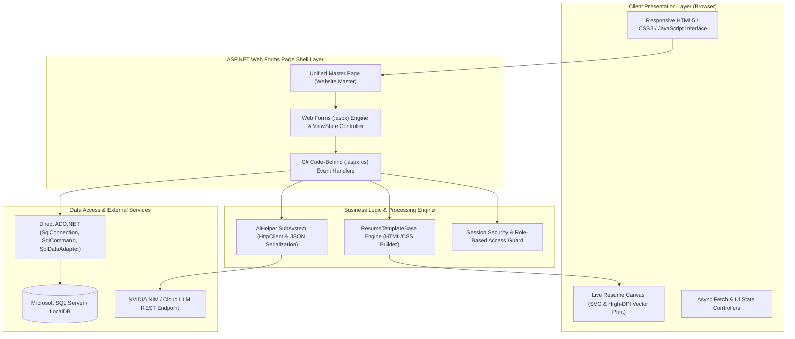

# System Architecture & Technical Design

## 1. Architectural Overview

**AI-Resume WebApplication** is built on the **ASP.NET Web Forms** platform (.NET Framework 4.8.1), designed with an emphasis on maintainability, predictable server-side state management, and clear architectural separation.

The system integrates an **AI-driven career enhancement engine** directly into a traditional 3-tier enterprise web application architecture without introducing unnecessary external abstractions or heavy dependencies.

---

## 2. Core Architectural Principles

### 2.1 Unified Page Shell Architecture
Instead of fragmenting the user experience across multiple distinct master pages (e.g., PublicMaster vs. AppMaster), the application uses a **Unified Master Page** (`Website.Master`).

* **Dynamic Navigation Toggling**: `Website.Master` checks `Session["userId"]` during the `Page_Load` phase to dynamically toggle between the **Public Marketing Header** and the **Candidate Application Sidebar**.
* **Page Layout Normalization**: Pages requiring full-width application views invoke `site.EnableAppLayout()` in their code-behind, standardizing content padding and viewport configuration.

### 2.2 Server-Side State Management
The system relies on native ASP.NET state management patterns:

* **Session State (`Session`)**: Stores user identity, session authentication keys, and cross-page preferences:
  * `Session["userId"]`: Primary key of the authenticated user.
  * `Session["userName"]`: Display name for dashboard personalization.
  * `Session["role"]`: Access level (`User` or `Admin`).
  * `Session["SelectedTemplate"]`: Current active resume template identifier (`modern`, `executive`, `minimalist`).
* **View State (`ViewState`)**: Handles control state persistence across single-page postbacks without re-querying the database:
  * `ViewState["Id"]`: Current entity ID being edited in CRUD forms (`AdminPanel.aspx`).
  * `ViewState["CurrentTemplate"]`: Live template selection during interactive builder editing.

### 2.3 Direct ADO.NET Data Access Architecture
Following industry-standard enterprise best practices for .NET Web Forms:
* Connections are created and managed explicitly via `SqlConnection`, `SqlCommand`, and `SqlDataAdapter`.
* Parameterized queries and explicit column projection prevent SQL injection and unnecessary memory overhead.
* Connection lifecycles strictly adhere to deterministic disposal (`using` blocks or explicit `.Close()`), ensuring zero database connection leaks.

---

## 3. Subsystem Breakdown

### 3.1 AI Career Assistance Subsystem (`AiHelper.cs`)
The AI engine provides LLM-driven resume enhancement:
1. **Lightweight HTTP Transport**: Communicates via `System.Net.Http.HttpClient` using standard REST endpoints (`chat/completions`).
2. **Payload Serialization**: Uses `Newtonsoft.Json` for structured JSON payload encoding and response parsing.
3. **Resilient Fallback Mechanism**: If network constraints, API rate limits, or connectivity issues occur, intelligent local heuristics automatically generate valid professional rewrites and ATS evaluations, ensuring continuous availability and deterministic behavior across any runtime environment.

### 3.2 Dynamic Template Rendering Engine (`ResumeTemplateBase.cs`)
Generates production-grade HTML resumes from raw database models (`ResumeData`):
* **Self-Contained Styling**: Injects CSS styles directly into the generated output container, eliminating browser cache staleness and guaranteeing visual fidelity.
* **Inline Vector Assets**: Uses embedded SVG icons for contact details and structural accents, preventing external image loading failures.
* **A4 Print Engine**: Seamless integration with `@media print` rules for browser-native vector PDF generation.

### 3.3 Role-Based Security Guard
* **Authentication Interceptors**: Every private view (`Dashboard.aspx`, `ResumeBuilder.aspx`, `Profile.aspx`, `Analyzer.aspx`, `Preview.aspx`) checks `Session["userId"]` on `Page_Load` and redirects unauthenticated requests to `Login.aspx`.
* **Administrative Interceptors**: `AdminPanel.aspx` verifies that `Session["role"] == "Admin"`, immediately redirecting unauthorized users.
