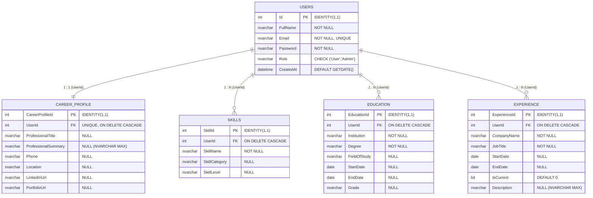

# Relational Database Design & Schema Specification

## 1. Entity-Relationship Model

The application database is architected around a candidate-centric relational model comprising 5 normalized tables. The schema enforces referential integrity through foreign key constraints and automated cascade deletions (`ON DELETE CASCADE`).

---

## 2. Table Specifications

### 2.1 `Users`
Stores account authentication credentials, user identity, authorization roles, and account registration timestamps.

| Column | Data Type | Nullable | Constraints & Default | Description |
| :--- | :--- | :---: | :--- | :--- |
| `Id` | `INT` | No | `PRIMARY KEY IDENTITY(1,1)` | Unique internal user identifier |
| `FullName` | `NVARCHAR(100)` | No | | Full name of the candidate or administrator |
| `Email` | `NVARCHAR(150)` | No | `UNIQUE` | User login email address |
| `Password` | `NVARCHAR(255)` | No | | User authentication password |
| `Role` | `NVARCHAR(20)` | No | `CHECK (Role IN ('User','Admin'))` | Authorization role level |
| `CreatedAt` | `DATETIME` | No | `DEFAULT GETDATE()` | Account creation timestamp |

---

### 2.2 `CareerProfile`
Maintains high-level professional positioning, narrative summaries, and contact links in a 1-to-1 relationship with the candidate account.

| Column | Data Type | Nullable | Constraints & Default | Description |
| :--- | :--- | :---: | :--- | :--- |
| `CareerProfileId` | `INT` | No | `PRIMARY KEY IDENTITY(1,1)` | Unique profile record identifier |
| `UserId` | `INT` | No | `FOREIGN KEY REFERENCES Users(Id) ON DELETE CASCADE, UNIQUE` | Associated user identifier (1:1) |
| `ProfessionalTitle` | `NVARCHAR(150)` | Yes | | Target professional headline (e.g. Lead Architect) |
| `ProfessionalSummary`| `NVARCHAR(MAX)` | Yes | | Narrative summary enhanced by AI rewrite engine |
| `Phone` | `NVARCHAR(50)` | Yes | | Contact phone number |
| `Location` | `NVARCHAR(100)` | Yes | | Geographic location (e.g. San Francisco, CA) |
| `LinkedInUrl` | `NVARCHAR(255)` | Yes | | Public LinkedIn profile URL |
| `PortfolioUrl` | `NVARCHAR(255)` | Yes | | Personal portfolio, GitHub, or website URL |

---

### 2.3 `Skills`
Stores technical proficiencies, programming languages, methodologies, and tools associated with the candidate.

| Column | Data Type | Nullable | Constraints & Default | Description |
| :--- | :--- | :---: | :--- | :--- |
| `SkillId` | `INT` | No | `PRIMARY KEY IDENTITY(1,1)` | Unique skill record identifier |
| `UserId` | `INT` | No | `FOREIGN KEY REFERENCES Users(Id) ON DELETE CASCADE` | Associated user identifier |
| `SkillName` | `NVARCHAR(100)` | No | | Name of the skill (e.g. C#, ASP.NET, Azure) |
| `SkillCategory` | `NVARCHAR(50)` | Yes | | Classification (Frontend, Backend, Cloud, Tools) |
| `SkillLevel` | `NVARCHAR(50)` | Yes | | Proficiency level (Beginner, Intermediate, Expert)|

---

### 2.4 `Education`
Tracks educational history, certifications, degrees, and institutions.

| Column | Data Type | Nullable | Constraints & Default | Description |
| :--- | :--- | :---: | :--- | :--- |
| `EducationId` | `INT` | No | `PRIMARY KEY IDENTITY(1,1)` | Unique education record identifier |
| `UserId` | `INT` | No | `FOREIGN KEY REFERENCES Users(Id) ON DELETE CASCADE` | Associated user identifier |
| `Institution` | `NVARCHAR(150)` | No | | Educational institution or university name |
| `Degree` | `NVARCHAR(100)` | No | | Degree obtained (e.g. B.Tech, B.S., M.S.) |
| `FieldOfStudy` | `NVARCHAR(100)` | Yes | | Major or field of specialization |
| `StartDate` | `DATE` | Yes | | Commencement date |
| `EndDate` | `DATE` | Yes | | Graduation or anticipated completion date |
| `Grade` | `NVARCHAR(50)` | Yes | | GPA, percentage, or graduation distinction |

---

### 2.5 `Experience`
Stores chronological work history, employment roles, and responsibilities.

| Column | Data Type | Nullable | Constraints & Default | Description |
| :--- | :--- | :---: | :--- | :--- |
| `ExperienceId` | `INT` | No | `PRIMARY KEY IDENTITY(1,1)` | Unique experience record identifier |
| `UserId` | `INT` | No | `FOREIGN KEY REFERENCES Users(Id) ON DELETE CASCADE` | Associated user identifier |
| `CompanyName` | `NVARCHAR(150)` | No | | Employing organization or company name |
| `JobTitle` | `NVARCHAR(150)` | No | | Role title held |
| `StartDate` | `DATE` | Yes | | Role start date |
| `EndDate` | `DATE` | Yes | | Role end date (NULL if currently employed) |
| `IsCurrent` | `BIT` | No | `DEFAULT 0` | Flag indicating active employment |
| `Description` | `NVARCHAR(MAX)` | Yes | | Bullet points of achievements and duties |

---

## 3. Database Integrity & Operations

### 3.1 Referential Integrity (`ON DELETE CASCADE`)
All child tables (`CareerProfile`, `Skills`, `Education`, `Experience`) establish foreign key relationships with `Users(Id)` configured with `ON DELETE CASCADE`. When an account is removed via `AdminPanel.aspx`, the SQL database engine automatically purges all related candidate data, preventing orphaned records.

### 3.2 SQL Setup & Seeding Script
The schema definition script is maintained in [`AI-Resume WebApplication/App_Data/AIResume_Database.sql`](../AI-Resume%20WebApplication/App_Data/AIResume_Database.sql). It executes idempotently, creating necessary tables, relationships, and default seed records for both administrator and candidate test accounts.
