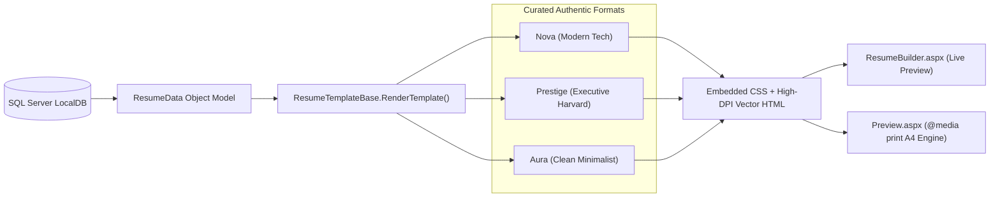

# Resume Templates Engine & PDF Export Specification

## 1. Template Engine Architecture

The template system is centralized in [`ResumeTemplateBase.cs`](../AI-Resume%20WebApplication/ResumeTemplateBase.cs). It transforms the strongly-typed `ResumeData` object model into recruiter-accepted, ATS-friendly HTML/CSS documents.



---

## 2. The 3 Industry Formats

### 2.1 Nova (Modern Tech Format)
* **Target Roles**: Software Engineers, DevOps, Full-Stack Developers, Cloud Architects.
* **Layout Structure**:
  * **Accent Stripe**: Solid primary-color top accent bar.
  * **Header**: Bold modern sans-serif typography (`Inter`) with prominent name and target title.
  * **Contact Bar**: Horizontal flexbox container featuring embedded vector SVG icons for email, phone, location, LinkedIn, and portfolio links.
  * **Timeline Entries**: Bold job title, bullet separator, company name, and a soft-accent rounded date badge.
  * **Skill Pills**: Dynamic flex-wrap container with rounded badges (`#F8FAFC` background with subtle `#CBD5E1` borders).

### 2.2 Prestige (Executive / Harvard Classic Format)
* **Target Roles**: Senior Leadership, Project Managers, Management Consultants, Finance Executives.
* **Layout Structure**:
  * **Centered Master Header**: Elegant serif typography (`Georgia`, `Playfair Display`) with centered candidate name and subtitle.
  * **Bullet-Separated Contact Line**: Clean single-line contact bar centered with `•` bullet dots.
  * **Full-Width Section Rules**: Uppercase section headings underscored with 1px solid horizontal accent rules.
  * **Balanced Timeline**: Left-aligned role and company with right-aligned dates on the same row.
  * **Core Competencies**: Clean badge format with colored left-accent indicator lines.

### 2.3 Aura (Clean Minimalist / Silicon Valley Format)
* **Target Roles**: Product Designers, UI/UX Specialists, Modern Startup Roles, Technical Writers.
* **Layout Structure**:
  * **Asymmetric Split Header**: Name and title on the left; right-aligned multi-line contact block on the right.
  * **Left-Accent Section Markers**: Headings highlighted by a 3.5px solid primary-color left border bar.
  * **Lightweight Skill Tags**: Soft gray tags (`#F1F5F9`) with breathable whitespace and minimal visual weight.

---

## 3. Visual Consistency & Embedded CSS Strategy

Traditional web applications often suffer from CSS caching bugs (where updated stylesheets are not refreshed by the browser) or print engines failing to resolve external `<link>` tags.

To eliminate this vulnerability:
1. **Embedded `<style>` Blocks**: `ResumeTemplateBase.GetEmbeddedStyles()` injects fully self-contained CSS rules directly at the root of the rendered resume string.
2. **Inline SVG Icons**: Contact icons are embedded as raw SVG markup rather than external image paths or font icons (e.g. FontAwesome), ensuring 100% rendering fidelity across any network, sandbox, or offline print environment.

---

## 4. Vector PDF Printing Engine (`Preview.aspx`)

High-quality PDF downloads are achieved using browser-native vector rendering via [`Preview.aspx`](../AI-Resume%20WebApplication/Preview.aspx).

### 4.1 `@media print` Calibration
When the candidate clicks **"Print / Save PDF"** or presses `Ctrl + P`:
* **Chrome Suppression**: Hides all sidebar navigation, top navigation bars, floating buttons, ambient background canvases, and cursor glow effects:
  ```css
  @media print {
      .sidebar, .navbar, .footer, .ambient-canvas, .viewer-toolbar,
      #appSidebar, #sidebarToggle, .cursor-glow, .cursor-dot, button, .btn {
          display: none !important;
          visibility: hidden !important;
      }
  }
  ```
* **Page Reset & Margins**: Sets standard A4 page dimensions with zero outer margins, allowing the template's internal padding to dictate the layout:
  ```css
  @page {
      size: A4 portrait;
      margin: 0mm;
  }
  ```
* **Container Reset**: Resets background colors to pure `#FFFFFF`, removes shadows and borders, sets `overflow: visible`, and ensures text prints in crisp 300+ DPI vector resolution.
